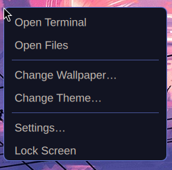

# OmaClick

English · [فارسی (Persian)](README.fa.md)

**A Windows-style right-click context menu for the Omarchy desktop.**

Right-clicking the bare desktop on most Linux desktops does nothing. OmaClick
puts a real context menu there — terminal, file manager, wallpaper, theme,
settings and lock screen — drawn in Omarchy's own popup styling, so it looks
like part of the shell rather than a bolt-on.

This is a fork of [shayanshahravi/OmaClick](https://github.com/shayanshahravi/OmaClick)
that adds French/English menu labels and draws the menu in the font Omarchy is
configured with instead of a hard-coded family.

[](LICENSE)
[](https://github.com/jotenakis2/OmaClick/actions/workflows/lint.yml)
[](https://omarchy.org)



## Features

- **Right-click anywhere on the desktop** to open a context menu at the pointer.
- **Clamped to the screen**: the card flips above the cursor when there is not
  enough room below, and never runs off the edge.
- **Omarchy-native look**: the card uses the active theme's popup colours,
  border and corner radius, and follows theme switches live.
- **Follows the Omarchy language**: rows come from a catalog, so a French
  install shows *Ouvrir un terminal*, *Changer de thème* and friends. Switching
  the language under Setup > Language re-renders the menu without a restart.
- **Follows the Omarchy font**: rows are drawn in `Style.font.menuFamily`, i.e.
  whatever `omarchy font set` configured (or `OMARCHY_MENU_FONT` when set), and
  sized from `omarchy display text size`. Row heights scale with the text size,
  so a larger font does not clip.
- **Keyboard friendly**: `Esc` closes it; clicking anywhere else does too, via a
  Hyprland focus grab.
- **Desktop gestures preserved**: double-clicking the wallpaper still changes
  the wallpaper, and right-double-clicking still changes the theme.
- **Multi-monitor aware**: every screen gets its own surface, and the menu opens
  on the screen you clicked.
- **One file to customise**: menu entries live in
  [`config/MenuEntries.js`](config/MenuEntries.js).

Default entries:

| Catalog key      | English           | French                  | Action                                        |
| ---------------- | ----------------- | ----------------------- | --------------------------------------------- |
| `menu.terminal`  | Open Terminal     | Ouvrir un terminal      | `omarchy-launch-terminal`                     |
| `menu.files`     | Open Files        | Ouvrir les fichiers     | `flea`                                        |
| `menu.wallpaper` | Change Wallpaper… | Changer d'arrière-plan… | `omarchy-theme-bg-switcher` + `omarchy-theme-bg-set` |
| `menu.theme`     | Change Theme…     | Changer de thème…       | `omarchy-theme-switcher` + `omarchy-theme-set` |
| `menu.settings`  | Settings…         | Paramètres…             | `omarchy-shell omasettings toggle`            |
| `menu.lock`      | Lock Screen       | Verrouiller l'écran     | `omarchy-system-lock`                         |

The `menu.settings` row is commented out in this fork, and *Open Files* launches
`flea` rather than `nautilus`.

## Requirements

- **Omarchy** (Quattro shell, `schemaVersion: 1` plugin manifests, and a shell
  that ships `qs.Commons.Translations` for the catalogs).
- A file manager on the *Open Files* row — this fork uses `flea`; edit the entry
  if you use another one.
- No extra packages, no background daemon, no Hyprland keybinding.

## Install

With the Omarchy plugin manager:

```sh
omarchy plugin add https://github.com/jotenakis2/OmaClick.git --enable
```

Or from a checkout, using the installer, which also disables the upstream
`io.github.shayanshahravi.omaclick` (two enabled copies would open two menus on
the same click):

```sh
git clone https://github.com/jotenakis2/OmaClick.git
cd OmaClick
./install.sh
```

Either way the plugin lands in
`~/.config/omarchy/plugins/io.github.jotenakis2.omaclick/` and is enabled
immediately. No shell restart is needed; right-click the desktop.

## Usage

- **Right-click the desktop** → the menu opens at the pointer.
- **Left-click a row** → runs its command and closes the menu.
- **`Esc` / click elsewhere** → closes the menu.
- **Double-click the wallpaper** → next wallpaper.
- **Right-double-click the wallpaper** → next theme.

## Configuration

Edit `config/MenuEntries.js` inside the installed plugin:

```sh
$EDITOR ~/.config/omarchy/plugins/io.github.jotenakis2.omaclick/config/MenuEntries.js
```

Each row is a command or a separator:

```js
var entries = [
  { key: "menu.terminal", label: "Open Terminal", command: "omarchy-launch-terminal" },
  { separator: true },
  { label: "My Script", command: "~/bin/my-script" }
]
```

- `key` is a catalog key from `i18n/<language>.json`. It is looked up when the
  row is drawn, so the row follows the Omarchy language.
- `label` is the fallback text: shown when the active catalog has no entry for
  `key`, and on its own for rows without a `key`.

Then reload the shell:

```sh
omarchy-shell shell rescanPlugins
```

Commands run detached through `Util.execDetached`, i.e. as your user, with your
environment — the same as running them in a terminal.

## Translations

`i18n/en.json` and `i18n/fr.json` hold the labels. To add a language, copy
`en.json` to a code from `$OMARCHY_PATH/default/i18n/locales.json` (for example
`de.json`) and translate the values; a missing string falls back to English,
then to the `label` in `MenuEntries.js`.

A row written without a `key` is never translated — that is the intended way to
keep your own scripts labelled as you like.

## Uninstall

```sh
omarchy plugin remove io.github.jotenakis2.omaclick
```

Bring the upstream plugin back with:

```sh
omarchy plugin enable io.github.shayanshahravi.omaclick
```

Or, to also put back an older hand-installed menu that `install.sh` retired:

```sh
./uninstall.sh --restore-legacy
```

Nothing outside the plugin folder is modified, so removing it leaves your
configuration untouched.

## How it works

OmaClick is a `service`-kind plugin: `Service.qml` is loaded into the running
`omarchy-shell` process (Quickshell).

- A transparent full-screen surface on the **bottom** layer, created after the
  wallpaper surface, receives pointer input on the bare desktop without covering
  windows or bottom-layer widgets.
- A second surface on the **overlay** layer draws the card itself, sized to the
  menu, and holds a focus grab so outside clicks dismiss it.
- Labels resolve through `Commons.Translations` over `i18n/`, and typography
  comes from `Style.font` (family, size, scaling) instead of local constants.
- Commands are launched with `Util.execDetached`, so the shell never blocks.

It does not start a second Quickshell process and does not patch Hyprland
configuration.

## License

[MIT](LICENSE) © Shayan Shahravi — fork changes © jotenakis2
